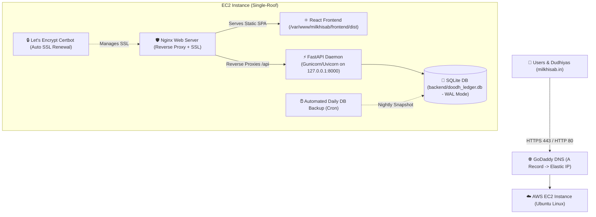

# 🥛 Complete AWS Single-Roof Hosting Guide for Milk Hisab
> **Host React Frontend, FastAPI Python Backend, SQLite Database, and `milkhisab.in` Domain on a Single AWS EC2 Server**

---

## 🏗️ Architecture Overview



---

## 📋 Step-by-Step Instructions

### Step 1: Launch your AWS EC2 Instance

1. Log in to the [AWS Management Console](https://console.aws.amazon.com/ec2/).
2. Select your closest AWS Region (e.g., **Asia Pacific (Mumbai) `ap-south-1`** for fastest response in India).
3. Click **Launch Instances**:
   * **Name:** `milkhisab-production`
   * **AMI (OS):** `Ubuntu Server 24.04 LTS` (or `22.04 LTS`) - 64-bit (x86)
   * **Instance Type:** `t2.micro` (Free Tier eligible) or `t3.small` (Recommended for smooth multi-worker concurrency)
   * **Key Pair:** Create a new key pair (e.g., `milkhisab-key.pem`) and download it safely to your computer.
4. **Network Settings (Security Group):**
   * Check **Allow SSH traffic from** -> `My IP` (or `Anywhere 0.0.0.0/0` if your ISP IP changes)
   * Check **Allow HTTP traffic from the internet (Port 80)**
   * Check **Allow HTTPS traffic from the internet (Port 443)**
5. **Storage:**
   * 20 GB gp3 SSD (Plenty of space for Ubuntu, logs, backups, and database).
6. Click **Launch Instance**.

---

### Step 2: Allocate & Associate an Elastic IP (Crucial!)

> [!IMPORTANT]
> By default, an EC2 Public IP changes whenever you stop or restart the server. An **Elastic IP** is a permanent, static IP address that never changes.

1. In the EC2 Sidebar, under **Network & Security**, click **Elastic IPs**.
2. Click **Allocate Elastic IP address** -> click **Allocate**.
3. Select your new Elastic IP -> click **Actions** -> **Associate Elastic IP address**.
4. In the Instance dropdown, select your `milkhisab-production` instance and click **Associate**.
5. **Copy this Elastic IP address** (e.g., `13.233.45.67`). You will need it for GoDaddy!

---

### Step 3: Configure GoDaddy DNS for `milkhisab.in`

1. Log in to [GoDaddy](https://account.godaddy.com/).
2. Go to **My Products** -> **Domains** -> find `milkhisab.in` -> click **Manage DNS** (or **DNS Records**).
3. Update/Add the following two records:

| Type | Name | Value (Points to) | TTL |
| :--- | :--- | :--- | :--- |
| **A** | `@` | `<Your EC2 Elastic IP>` (e.g. `13.233.45.67`) | 1/2 Hour (or 600 seconds) |
| **CNAME** | `www` | `milkhisab.in` | 1/2 Hour |

*(Note: DNS changes take between 5 to 30 minutes to propagate across India).*

---

### Step 4: Connect to your EC2 Server & Run Automated Setup

1. Open your computer terminal (PowerShell, Git Bash, or Terminal):
   ```bash
   # On Mac / Linux / Git Bash: Set permissions for key
   chmod 400 milkhisab-key.pem

   # Connect to your EC2 instance:
   ssh -i "milkhisab-key.pem" ubuntu@<YOUR_ELASTIC_IP>
   ```

2. Once connected to Ubuntu on EC2, run the **1-command automated setup script**:
   ```bash
   curl -fsSL https://raw.githubusercontent.com/sanjayyadav138/milk-hisab/main/deploy/setup-ec2.sh | sudo bash
   ```

   **What this automated script does in ~2 minutes:**
   * Installs Python 3, Node.js 20 LTS, Nginx, UFW firewall, and Certbot.
   * Clones your repository to `/var/www/milkhisab`.
   * Builds the Python backend venv with Gunicorn and Uvicorn workers.
   * Compiles the React frontend production build (`npm run build`).
   * Configures Nginx with caching, gzip, security headers, and reverse proxying.
   * Configures and starts the `milkhisab.service` systemd daemon.
   * Enables the UFW firewall (Ports 22, 80, 443).

---

### Step 5: Install Free SSL Certificate (HTTPS)

Once your GoDaddy domain (`milkhisab.in`) has propagated to your Elastic IP:

```bash
sudo certbot --nginx -d milkhisab.in -d www.milkhisab.in
```

* Enter your email address for renewal notices.
* Agree to terms (`Y`).
* Certbot will automatically configure Nginx with SSL and auto-redirect HTTP to HTTPS!
* Certbot creates an automatic background timer (`systemctl status certbot.timer`) to renew your certificate every 60 days for free.

---

### Step 6: Setup Nightly Automated SQLite Database Backups

Because your SQLite database runs right inside `/var/www/milkhisab/backend/doodh_ledger.db`, set up a daily automated backup crontab:

```bash
sudo crontab -e
```

Add this line at the bottom to create a compressed backup every night at 2:00 AM (kept for 30 days):
```cron
0 2 * * * /var/www/milkhisab/deploy/backup-db.sh >> /var/log/milkhisab/backup.log 2>&1
```

---

## 🔄 How to Push Updates in Future

Whenever you make code updates or changes locally and push to GitHub:
```bash
git add .
git commit -m "Update feature"
git push origin main
```

To deploy the update on your EC2 server in 5 seconds, simply SSH in and run:
```bash
ssh -i "milkhisab-key.pem" ubuntu@<YOUR_ELASTIC_IP>
bash /var/www/milkhisab/deploy/update.sh
```

---

## 🛠️ Useful Server Commands

* **Check Backend Status:**
  ```bash
  sudo systemctl status milkhisab
  ```
* **Restart Backend:**
  ```bash
  sudo systemctl restart milkhisab
  ```
* **View Live Backend Logs:**
  ```bash
  sudo journalctl -u milkhisab -f
  # Or check log file:
  tail -f /var/log/milkhisab/error.log
  ```
* **Check Nginx Status:**
  ```bash
  sudo systemctl status nginx
  sudo nginx -t
  sudo systemctl reload nginx
  ```
* **Manual Database Backup:**
  ```bash
  sudo bash /var/www/milkhisab/deploy/backup-db.sh
  ```
